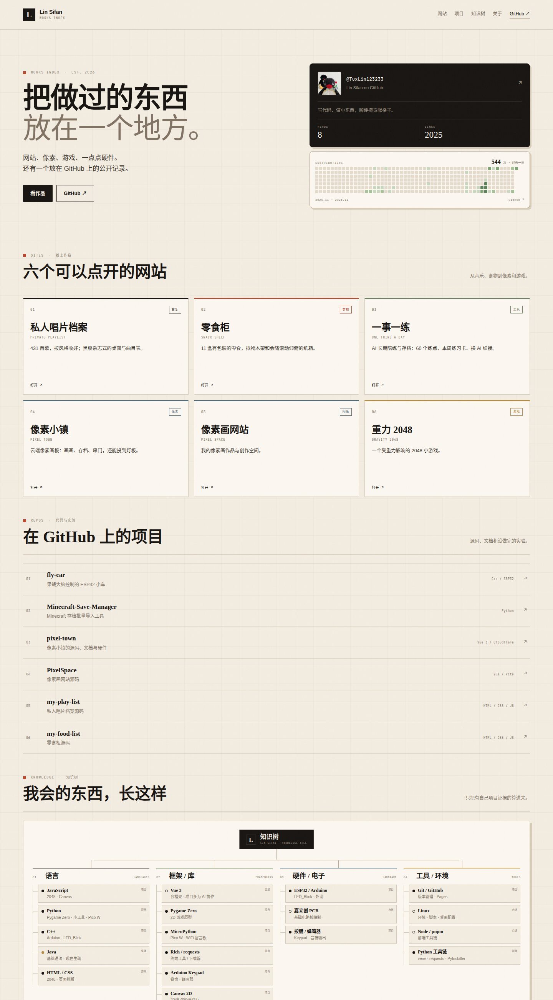
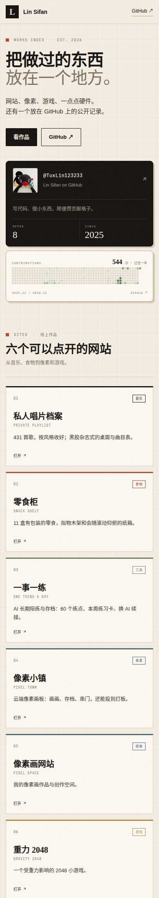
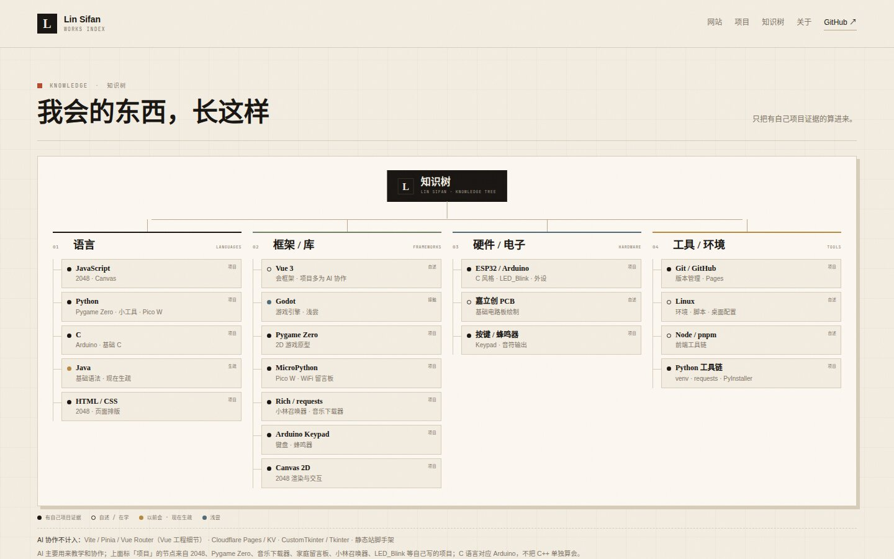

# Lin Sifan · 作品索引

> 网站、像素、游戏，还有一些没做完的实验。

**在线访问：<https://tuxlin123233.github.io/my-works/>**

<p align="center">
  
</p>

<p align="center">
  
</p>

## 关于

一个把作品放在一起的入口页。收录 6 个线上网站和 6 个 GitHub 仓库；右侧是 GitHub 头像、公开仓库数、过去一年贡献数和完整的贡献格子。

## 收录

线上网站：

- 私人唱片档案
- 零食柜
- 一事一练
- 像素小镇
- 像素画网站
- 重力 2048

代码项目：

- fly-car
- Minecraft-Save-Manager
- pixel-town
- PixelSpace
- my-play-list
- my-food-list

## 知识树

页面里有一张知识树：

- 语言：JavaScript / Python / C / Java / HTML-CSS
- 框架 / 库：Vue 3、Godot（浅尝）、Pygame Zero、MicroPython、Rich / requests、Arduino Keypad、Canvas 2D
- 硬件：ESP32 / Arduino、嘉立创 PCB、按键 / 蜂鸣器
- 工具：Git / GitHub、Linux、Node / pnpm、Python 工具链

树节点区分「有自己项目证据」「自述 / 在学」「以前会 · 现在生疏」「浅尝」。AI 主要用来教学和协作；本地项目 2048、Pygame Zero、音乐下载器、家庭留言板、小林召唤器、LED_Blink 都是自己写的；Arduino 归到 C 的基础，不单独算 C++。AI 协作过的工程细节单列在下面，不计入能力证据。

<p align="center">
  
</p>

## 数据更新

GitHub 贡献格子数据缓存在 `data/contributions.json`，来自公开的贡献统计接口；页面构建时生成 `js/data.js`。

```bash
python3 tools/build_site_data.py
```

如果贡献数据需要刷新，替换 `data/contributions.json` 后重新运行构建脚本即可。

## 本地预览

```bash
python3 -m http.server 8000
```

## 技术栈

- 原生 HTML / CSS / JavaScript，无框架、无构建依赖
- 头像本地存放，贡献格子静态渲染，不依赖运行时第三方接口
- 部署：GitHub Pages

## 隐私

- 页面不加载第三方统计、广告或追踪脚本，不设置 Cookie。
- 头像和贡献数据存放在本地静态文件中，不依赖运行时第三方接口。
- 全站设置 `referrer-policy: no-referrer`，外链使用 `noopener noreferrer`。
- 贡献格子只显示颜色层级，不展示具体日期和次数。
- 站点不显示邮箱、位置、电话等联系方式；点击 GitHub 会跳转到公开资料页。

## 版权

- 页面文字、视觉设计与 SVG/图形插画：© 2026 Lin Sifan，未经许可请勿转载。
- 代码部分：以 [MIT License](LICENSE) 开源。
